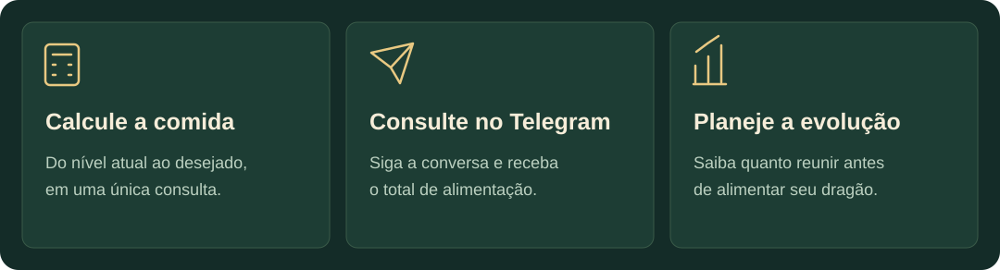
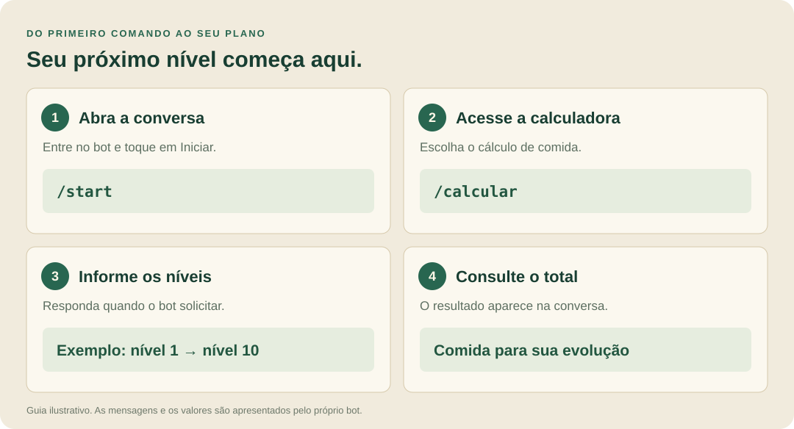

<div align="center">


# DragonFit Intelligence

**Planeje a alimentação dos seus dragões pelo Telegram.**

Calcule a quantidade de comida necessária para evoluir entre dois níveis em Dragon City, em uma conversa com o bot.


<sub>Arte conceitual da identidade DragonFit.</sub>

[](https://t.me/DragonFitIntelligencebot)
[](https://dragonfit.vercel.app/)

[Acessar o bot](https://t.me/DragonFitIntelligencebot) · [Visitar o site](https://dragonfit.vercel.app/) · [Enviar uma sugestão](https://github.com/Davibzf/DragonFitIntelligence/issues)

</div>

---

<p align="center">
  <a href="#sobre-o-projeto">Sobre</a> ·
  <a href="#o-que-você-pode-fazer">Recursos</a> ·
  <a href="#como-usar">Primeiros passos</a> ·
  <a href="#comandos">Comandos</a> ·
  <a href="#dúvidas-frequentes">Dúvidas</a> ·
  <a href="#problemas-e-sugestões">Feedback</a>
</p>

## Sobre o projeto

O **DragonFit Intelligence** é um bot para Telegram que ajuda jogadores de Dragon City a planejar a alimentação de seus dragões. Você informa o nível inicial e o nível desejado, e o bot consulta a tabela de comida usada pelo projeto para calcular o total necessário.

Este repositório é a página pública de apresentação e documentação do bot. **O código-fonte não está disponível publicamente.** Para utilizar a calculadora, basta acessar o Telegram; não é necessário clonar o repositório nem configurar um ambiente de desenvolvimento.

## O que você pode fazer



- **Calcular a comida entre dois níveis:** informe de onde seu dragão parte e até onde pretende evoluí-lo.
- **Consultar o resultado no Telegram:** siga as instruções da conversa para receber o total.
- **Ler valores com facilidade:** os totais usam ponto como separador de milhares.
- **Enviar sugestões e relatar problemas:** use as [issues deste repositório](https://github.com/Davibzf/DragonFitIntelligence/issues).

## Como usar

[](https://t.me/DragonFitIntelligencebot)

> As ilustrações explicam o fluxo de uso; não são capturas da interface do Telegram. As mensagens e o resultado são apresentados pelo próprio bot.

1. Abra o [@DragonFitIntelligencebot](https://t.me/DragonFitIntelligencebot) no Telegram.
2. Toque em **Iniciar / Start** ou envie `/start`.
3. Selecione a opção de calculadora de comida ou envie `/calcular`.
4. Quando o bot solicitar, informe o **nível inicial** e o **nível final**.
5. Consulte a quantidade total de comida retornada pelo bot.

### Exemplo de consulta

Para planejar a evolução de um dragão do nível 1 ao nível 10, informe estes valores quando forem solicitados:

| Campo | Valor |
| --- | --- |
| Nível inicial | `1` |
| Nível final | `10` |

O total de comida será informado na conversa, conforme a tabela disponível no bot.

## Comandos

| Comando | Função |
| --- | --- |
| `/start` | Inicia a conversa com o bot. |
| `/calcular` | Abre o fluxo de cálculo de comida. |

## Antes de calcular

- Informe apenas **números inteiros**.
- O nível inicial deve ser **menor ou igual** ao nível final.
- O cálculo depende dos níveis contemplados na tabela do projeto.
- Se um nível ainda não estiver disponível, o bot poderá não retornar o cálculo.
- Confira no jogo as condições e os requisitos para evoluir seu dragão.

## Dúvidas frequentes

**Preciso instalar alguma coisa?**  
Você precisa acessar o Telegram, pelo aplicativo ou pela versão web. O bot não exige instalação adicional.

**Posso executar o bot no meu computador?**  
Este repositório não inclui o código-fonte nem instruções de hospedagem. O uso público acontece pelo bot no Telegram.

**O resultado considera qualquer situação do jogo?**  
O cálculo utiliza a tabela de comida do projeto. Condições específicas do jogo devem ser conferidas no próprio Dragon City.

**O bot é oficial de Dragon City?**  
Não. O DragonFit é um projeto independente de fãs, sem vínculo oficial com a Socialpoint.

## Problemas e sugestões

Encontrou um cálculo inesperado ou teve dificuldade para usar o bot? [Abra uma issue](https://github.com/Davibzf/DragonFitIntelligence/issues/new) e, se possível, inclua:

- Os níveis inicial e final informados.
- O resultado recebido ou a mensagem exibida.
- O resultado esperado e como você chegou a ele.
- Uma captura de tela, sem dados pessoais.

Sugestões de melhoria também são bem-vindas. Não publique tokens, credenciais ou conversas que contenham informações privadas.

## Por dentro deste repositório

```text
DragonFitIntelligence/
├── README.md                  # Apresentação e guia de uso
└── assets/
    ├── dragonfit-logo.webp     # Identidade do projeto
    ├── dragonfit-cover.webp    # Arte conceitual de capa
    ├── features.svg            # Recursos em um resumo visual
    └── quick-start.svg         # Passo a passo ilustrado
```

Os arquivos públicos documentam o projeto e sua identidade visual. O funcionamento do bot é disponibilizado pelo Telegram, e seu código permanece privado.

## Projeto DragonFit

| Link | Onde acessar |
| --- | --- |
| Bot no Telegram | [@DragonFitIntelligencebot](https://t.me/DragonFitIntelligencebot) |
| Site e atlas dos dragões | [dragonfit.vercel.app](https://dragonfit.vercel.app/) |
| Autor | [Davibzf](https://github.com/Davibzf) |

## Direitos e créditos

A logo e a arte conceitual de capa fazem parte da identidade do **DragonFit** e também são utilizadas no [site do projeto](https://dragonfit.vercel.app/). Os diagramas deste README foram criados para apresentar os recursos e o fluxo de uso.

Dragon City, seus personagens, nomes e artes pertencem à **Socialpoint e aos respectivos titulares**. Este projeto é independente e não representa um produto oficial da empresa.

**Todos os direitos reservados.** A publicação deste repositório não concede licença de uso, redistribuição ou modificação do código-fonte privado do bot.

---

<div align="center">

**Pronto para planejar a próxima evolução?**

[🐉 Abrir o DragonFit Intelligence no Telegram](https://t.me/DragonFitIntelligencebot)

Feito por [Davibzf](https://github.com/Davibzf) para a comunidade de Dragon City.

</div>
